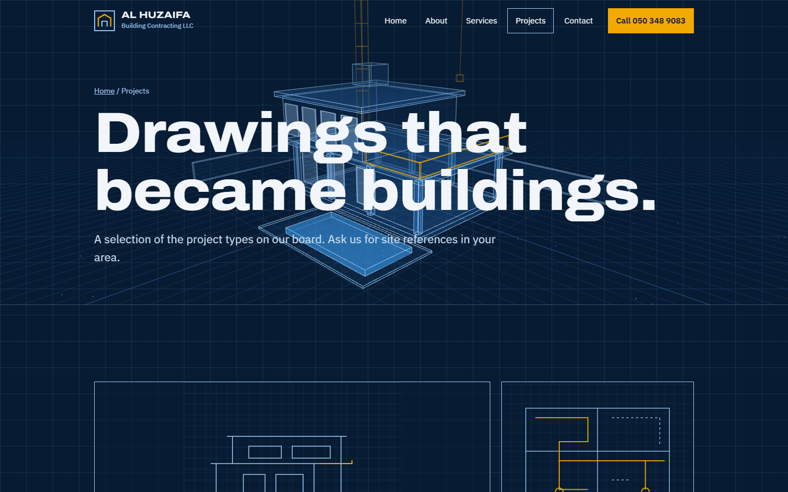

# Al Huzaifa Building Contracting LLC

A multi-page static concept website for **Al Huzaifa Building Contracting LLC**, a Dubai-based construction contractor specializing in private villas, residential and commercial buildings, MEP works, and renovations from their base in Ras Al Khor.

Designed around an architectural **blueprint identity**—deep navy grid paper, cyan technical linework, and construction-amber highlights—paired with a real-time **Three.js 3D blueprint villa** that assembles itself line by line beside a tower crane.

---

## Screenshots

### Desktop — Interactive 3D Blueprint Hero


### Pages & Responsive Views

| Services | Projects |
| :---: | :---: |
|  |  |

| Contact & Map | Mobile Responsive (`390×844`) |
| :---: | :---: |
|  |  |

<details>
<summary>View Full Landing Page Screenshot</summary>


</details>

---

## Key Features

- **Interactive Three.js 3D Blueprint Scene (`assets/js/scene.js`)**:
  - Built with bundled **Three.js r128** (`assets/js/vendor/three.min.js`) with zero external runtime JS dependencies.
  - Animates a G+1 cantilevered villa assembling element-by-element from slab to roof next to an animated tower crane and swimming pool.
  - Updates the live `Built: 0% → 100%` readout inside the hero drawing-sheet overlay.
  - Includes a compact `data-scene="mini"` variant across inner pages and respects `prefers-reduced-motion`.
- **Custom Technical SVG Blueprint Plates**: Hand-crafted SVG architectural elevation and MEP schematic drawings for villas, G+7 residential buildings, MEP layouts, renovations, and commercial blocks.
- **WhatsApp-Integrated Contact Form (`assets/js/main.js`)**: Validates name, phone number, and project scope, then opens WhatsApp (`+971 50 348 9083`) pre-filled with the visitor's enquiry.
- **Accessibility & Responsive Design**: Skip-to-content link, semantic landmarks, `aria-live` status updates, mobile drawer navigation, and fluid `clamp()` typography.
- **Zero Build Step**: Pure HTML5, CSS3, and vanilla JavaScript—ready to open or deploy directly.

---

## Pages Included

| File | Page | Highlights |
| :--- | :--- | :--- |
| `index.html` | **Home** | 3D blueprint assembly hero, contractor workflow (5 stages), service overview, recent drawing plates, CTA |
| `about.html` | **About** | Site-engineer-led delivery model, transparent BOQ pricing, weekly photo reporting, clean handover standards |
| `services.html` | **Services** | Detailed breakdowns for Villa Construction, Building Construction, MEP Works, and Renovation & Extension |
| `projects.html` | **Projects** | Architectural SVG blueprint plates across G+1 villas, G+2 MEP layouts, G+7 residential, extensions, and commercial blocks |
| `contact.html` | **Contact** | Ras Al Khor office info, phone/WhatsApp links, validated enquiry form, embedded Google Map |
| `404.html` | **Not Found** | Custom blueprint-styled 404 page (`This drawing is missing.`) |

---

## Design System & Typography

- **Fonts**: `Archivo` (variable width & weight for architectural display headings) and `IBM Plex Sans` (body copy) via Google Fonts.
- **Color Tokens** (`assets/css/style.css`):
  - Blueprint Ink (Background): `#071B33`
  - Structural Blue: `#0E3A6B`
  - Technical Linework Cyan: `#9CC8F0`
  - Paper Section Surface: `#F2F6FA`
  - Construction Amber Accent: `#F2A900`

---

## Project Structure

```text
al-huzaifa-construction/
├── index.html
├── about.html
├── services.html
├── projects.html
├── contact.html
├── 404.html
├── favicon.svg
├── screenshots/
│   ├── home-hero.png
│   ├── home-full.png
│   ├── services.png
│   ├── projects.png
│   ├── contact.png
│   └── mobile-home.png
└── assets/
    ├── css/
    │   └── style.css
    └── js/
        ├── main.js
        ├── scene.js
        └── vendor/
            └── three.min.js
```

---

## Run Locally

No build tools or package installation required. Clone the repository and serve it with any static file server:

```bash
git clone https://github.com/hassaankhalid225/al-huzaifa-construction.git
cd al-huzaifa-construction

# Using Node.js
npx serve .

# Or using Python
python -m http.server 8000
```

Then open `http://localhost:8000` (or the port shown by `serve`).

---

## Deployment

Deployable out of the box on **Vercel**, **Netlify**, or **GitHub Pages**:

1. Import this repository into your hosting provider.
2. Leave the **Build Command** empty and set the **Output Directory** to `.` (root).
3. Deploy.

---

## Notes

- Contact details (`M05, Al Marri-7 Building, Manama Street, Ras Al Khor, Dubai`, `04 341 1262`, `050 348 9083`) come from public business directory listings.
- Project descriptions and SVG illustrations are concept material for design review.
