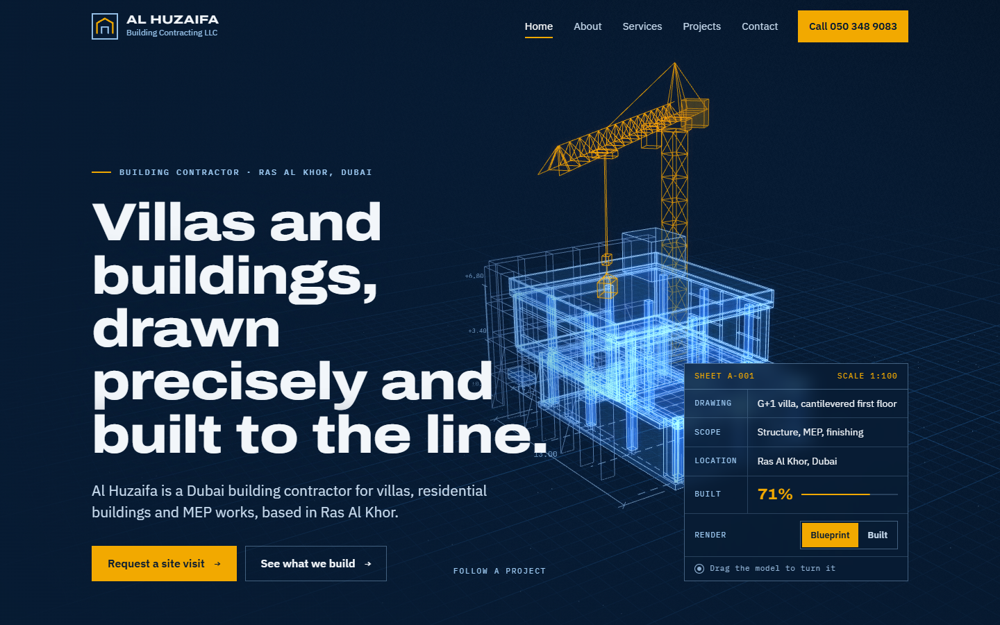
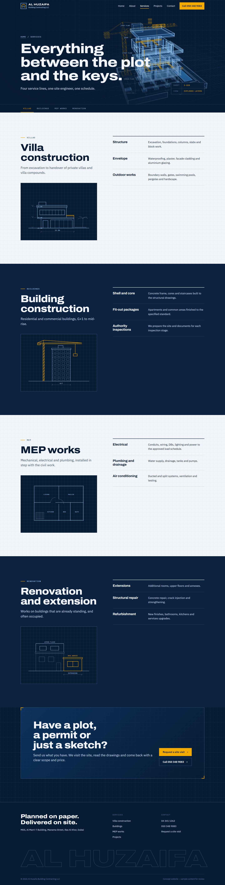
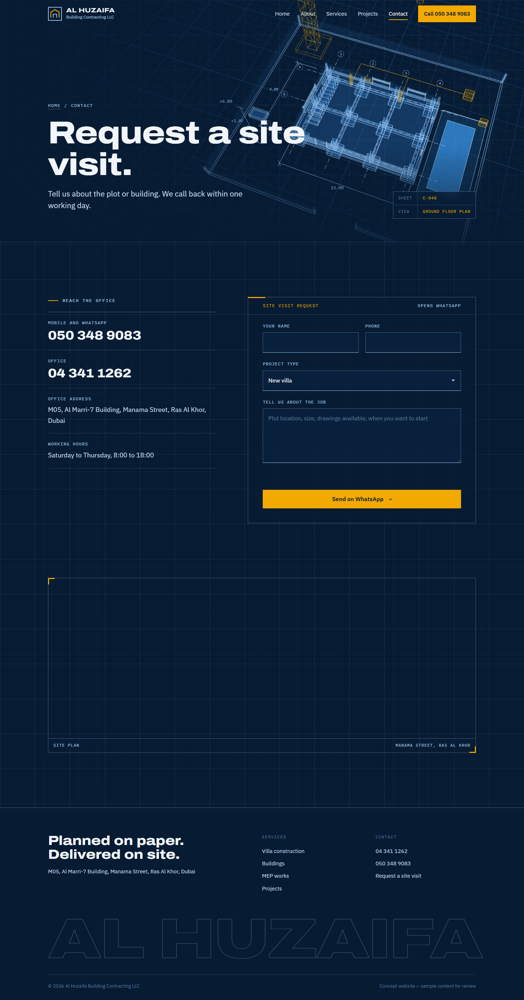
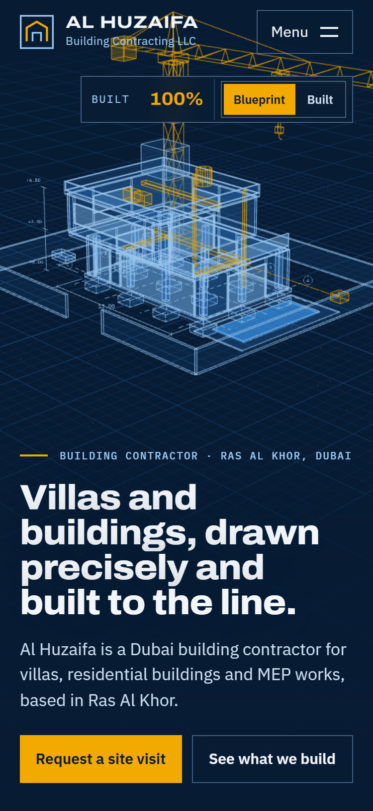
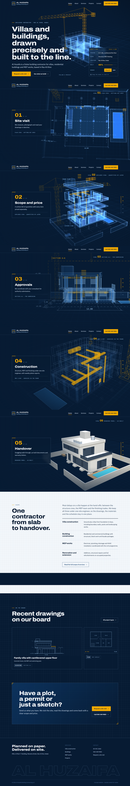

# Al Huzaifa Building Contracting LLC

A multi-page static concept website for **Al Huzaifa Building Contracting LLC**, a Dubai-based construction contractor specializing in private villas, residential and commercial buildings, MEP works, and renovations from their base in Ras Al Khor.

Designed around an architectural **blueprint identity**—deep navy grid paper, cyan technical linework and construction-amber highlights—and built around a real-time **Three.js 3D villa** that assembles itself stage by stage while an articulated tower crane lifts each element into place. On the home page the same model then follows the visitor through the five-stage process as they scroll.

---

## Screenshots

### Desktop — Interactive 3D Blueprint Hero


### Pages & Responsive Views

| Services | Projects |
| :---: | :---: |
|  |  |

| Contact & Map | Mobile (`375×812`) |
| :---: | :---: |
|  |  |

<details>
<summary>View Full Landing Page Screenshot</summary>



</details>

---

## Key Features

- **Cinematic 3D hero (`assets/js/scene.js`, Three.js r128 vendored locally)**
  - A G+1 cantilevered villa modelled in detail: structural grid with bubbles, pad footings, ground beams and starter bars, slab rebar mesh, columns and beams, walls with real window openings, a 12-riser stair, roof parapets and stair head, terrace balustrade, pool, boundary walls, dimension lines and level tags.
  - Builds itself in ten stages (setting-out → foundations → … → glazing → external works); scaffolding goes up with the first floor and is struck at handover.
  - An articulated tower crane (lattice mast, slewing jib, trolley, hoist cable, hook and slung load) picks each stage's load from a laydown area, slews and lowers it onto the building.
  - MEP runs in amber: risers, ducts, conduits, drainage to a manhole, roof tank and AC units.
  - **Blueprint ⇄ Built** render toggle (lit materials with soft shadows) and **drag to orbit** (mouse; horizontal swipe on touch). Live `Built %` readout in the drawing-sheet overlay.
  - Hand-written post pass (line glow, vignette, grain) using a multisample `WebGLRenderTarget` + `ShaderMaterial` on capable desktops; automatically dropped, with shadows, if frame times are poor.
- **Scroll story on the home page**: the canvas is pinned while the five process chapters scroll past, and the camera and render mode change with each one—plan view of the setting-out grid (Site visit), exploded layers (Scope and price), section A–A via a clipping plane (Approvals), MEP x-ray with scaffold (Construction) and the rendered as-built model (Handover). A HUD shows the current view and progress.
- **Inner page headers** reuse the model in different views: rendered (About), exploded (Services), blueprint (Projects), ground-floor plan cut (Contact) and an unfinished drawing with a load hanging from the crane (404).
- **Projects gallery**: SVG drawing plates that plot themselves when scrolled into view; hover (or the view buttons) wipes in a second sheet—section, MEP overlay, plan or steel frame—that draws itself too. Filter buttons by project type.
- **Plotter loading screen** (first visit per session, ~1.2 s, click or any key skips, pure-CSS timing so it never blocks if JS fails) and a **blueprint wipe page transition** between pages.
- **WhatsApp-integrated contact form (`assets/js/main.js`)**: validates name, phone number and project scope, then opens WhatsApp (`+971 50 348 9083`) pre-filled with the visitor's enquiry.
- **Performance & resilience**: rendering pauses when the canvas is off-screen or the tab is hidden; device pixel ratio capped at 2 (1.5 on phones); phones get a lighter model with no shadows or post-processing. Without WebGL the pages show an SVG fallback drawing and a static process board.
- **Accessibility**: skip link, semantic landmarks, `aria-pressed` toggles, `aria-live` form status, visible amber focus rings, full-screen mobile menu (Escape closes). `prefers-reduced-motion` turns off the loader, transitions, auto-motion and scroll-driven camera, leaving a static finished frame.
- **Zero build step**: plain HTML, CSS and vanilla JavaScript.

---

## Pages Included

| File | Page | Highlights |
| :--- | :--- | :--- |
| `index.html` | **Home** | 3D build hero with crane, scroll-driven 5-stage process story, service overview, recent drawing plates, CTA |
| `about.html` | **About** | Rendered model header, profile, one-site-engineer diagram, four working standards |
| `services.html` | **Services** | Exploded-model header, sticky section nav, four service sheets with self-drawing plates |
| `projects.html` | **Projects** | Filterable gallery of two-sheet drawing plates: G+1 villa, G+2 MEP layout, G+7 residential, extension, showroom |
| `contact.html` | **Contact** | Ras Al Khor office info, phone/WhatsApp links, validated enquiry form, embedded Google Map |
| `404.html` | **Not Found** | Custom blueprint-styled 404 page (`This drawing is missing.`) |

---

## Design System & Typography

- **Fonts**: `Archivo` (variable width & weight for display headings), `IBM Plex Sans` (body copy) and `IBM Plex Mono` (drawing labels, title blocks) via Google Fonts.
- **Color Tokens** (`assets/css/style.css`):
  - Blueprint Ink (Background): `#071B33`
  - Structural Blue: `#0E3A6B`
  - Technical Linework Cyan: `#9CC8F0`
  - Paper Section Surface: `#F2F6FA`
  - Construction Amber Accent: `#F2A900`

---

## Project Structure

```text
al-huzaifa-construction/
├── index.html
├── about.html
├── services.html
├── projects.html
├── contact.html
├── 404.html
├── favicon.svg
├── screenshots/
│   ├── home-hero.png
│   ├── home-full.png
│   ├── services.png
│   ├── projects.png
│   ├── contact.png
│   └── mobile-home.png
└── assets/
    ├── css/
    │   └── style.css
    └── js/
        ├── main.js
        ├── scene.js
        └── vendor/
            └── three.min.js
```

---

## Run Locally

No build tools or package installation required. Clone the repository and serve it with any static file server:

```bash
git clone https://github.com/hassaankhalid225/al-huzaifa-construction.git
cd al-huzaifa-construction

# Using Node.js
npx serve .

# Or using Python
python -m http.server 8000
```

Then open `http://localhost:8000` (or the port shown by `serve`).

---

## Deployment

Deployable out of the box on **Vercel**, **Netlify**, or **GitHub Pages**:

1. Import this repository into your hosting provider.
2. Leave the **Build Command** empty and set the **Output Directory** to `.` (root).
3. Deploy.

---

## Notes

- Contact details (`M05, Al Marri-7 Building, Manama Street, Ras Al Khor, Dubai`, `04 341 1262`, `050 348 9083`) come from public business directory listings.
- Project descriptions and SVG illustrations are concept material for design review.
